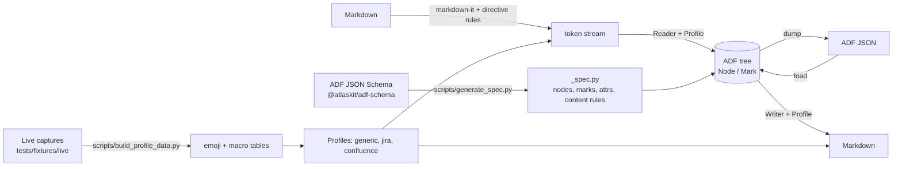

# adflux design

## Goals

1. Agents and people read and write Jira and Confluence content as Markdown.
2. Nothing is lost: ADF → Markdown → ADF reproduces the document.
3. The Markdown stays idiomatic and readable; exotic content degrades to explicit, still
   readable syntax rather than opaque blobs.
4. ADF stays a first-class format; the library knows the whole ADF spec, not a subset.

## Architecture



* **The IR is the ADF tree.** ADF is a serialized ProseMirror document, so `Node`
  (type, attrs, content, marks, text) and `Mark` model it exactly. There is no second
  document model to drift from ADF (the old panflute IR needed per-construct envelopes).
  Unknown JSON keys are kept in `Node.extra`, so content newer than the vendored schema
  survives.
* **The spec is generated.** `generate_spec.py` folds the official JSON Schema (all
  `anyOf` variants, `$ref` groups) into one table per node and mark: attributes with
  kind/enum/pattern/range, required attributes, allowed children, allowed marks,
  inline/block group. The reader types directive attributes from it, the writer knows
  which nodes can use the generic directive form, and the validator explains errors in
  plain words. `--check` in CI keeps it in sync with the vendored schema.
* **Validation has two passes.** The structural pass from the spec is fast and names
  exact paths; the official JSON Schema (Draft 4) is the final authority but is slow on
  deep documents (its `anyOf` trees are exponential), so `to_adf` runs only the
  structural pass and `validate()` adds the schema pass.

## Markdown dialect

CommonMark + GFM tables, strikethrough, task lists, plus the generic directive proposal
(`:::container`, `::leaf`, `:inline[label]{attrs}`) used by remark-directive, MyST and
others. Directives were chosen over HTML comments or `<details>`-style HTML because they
are readable, nest, carry typed attributes, and are already familiar to agents.

| Choice | Why |
| --- | --- |
| `> [!NOTE]` alerts for panels | GitHub syntax, renders on GitHub, agents know it |
| `<https://…>` for inlineCard, `[t](u)` for link | the two Markdown link forms map to the two ADF link kinds |
| `:status[DONE]{color=green}` etc. | short directives named after the node |
| Generic directive = node type name | every ADF node is writable without a special case |
| ```` ```adf ```` raw fallback | last resort for content the dialect cannot express (unknown node types) |
| Outer containers use more colons | unambiguous nesting without indentation |
| `adf.`-prefixed reserved attributes on macros | macro parameters keep their own names |

### Writer strategy

For each node, the writer tries, in order: idiomatic Markdown, a short directive, the
generic directive with all attributes, raw ADF. A form is used only if it loses nothing.

Inline content is rendered with `*`/`**`/`~~` delimiters, then **re-parsed**; if the
result differs (CommonMark flanking rules around punctuation), the paragraph is rendered
with `<em>`/`<strong>`/`<del>` instead. Spaces at the edges of emphasis move outside
(`**bold **` is not emphasis in CommonMark). Text is escaped only where Markdown would
misread it: block starts at line beginnings, `:name:` only when `name` is a known emoji,
`!` before a link, `{` after a directive, adjacent lists of one kind switch markers.

### Profiles

Both products store any schema-valid ADF unchanged (verified live for every node type),
so profiles do not change the ADF model; they change what text means and what renders:

| | generic | jira | confluence |
| --- | --- | --- | --- |
| Emoji | standard + Atlassian sets | + Jira wiki shortcuts (`:tick:` …) | + Confluence emoticon names |
| Unknown directive | error | error | Confluence macro |
| Macros | catalog known | warn (not rendered) | catalog, native mapping |
| Layouts, decisions | ok | warn | ok |

The macro catalog comes from Confluence's macro browser (parameters, types, defaults,
enums) plus the ADF Confluence produced for each macro through
`/wiki/rest/api/contentbody/convert/atlas_doc_format`, which shows which macros become
native nodes (`info`/`tip`/`note`/`warning` → panel, `code`/`noformat` → codeBlock,
`expand`, `status`, `bgcolor` → custom panel). A macro's label fills its default
parameter, so `:jira[PROJ-1]` and `::toc{maxLevel=3}` read naturally.

## Equality

`normalize()` merges adjacent text with equal marks, drops empty text and orders marks
like the editor. `canonical()` also drops what servers add or regenerate: `localId`,
`macroMetadata`, table/cell defaults, mention `accessLevel`, status `style`. Round-trip
tests compare canonical forms.

## Testing

| Suite | What it proves |
| --- | --- |
| `tests/unit` | attribute grammar, spec, model, validator, profiles, reader and writer per construct, CLI, every example in the syntax guide |
| `tests/roundtrip/test_live.py` | every node as Jira and Confluence returned it, all 111 Confluence macros, Jira wiki output round-trip |
| `tests/roundtrip/test_property.py` | random schema-valid documents round-trip in all three profiles (Hypothesis; `HYPOTHESIS_PROFILE=thorough` for 2000 cases) |
| `tests/e2e` | real pages and issues: the product stores adflux output unchanged and its stored ADF round-trips |

## Known limits

* Hard-coded emoji tables reflect one site's capture; custom site emoji resolve through
  `:emoji[name]{id=…}`.
* Mentions written as `@Name` need a resolver (codas supply one); otherwise they stay
  text with a warning.
* Media nodes reference uploaded files by id; uploading is the caller's job.
